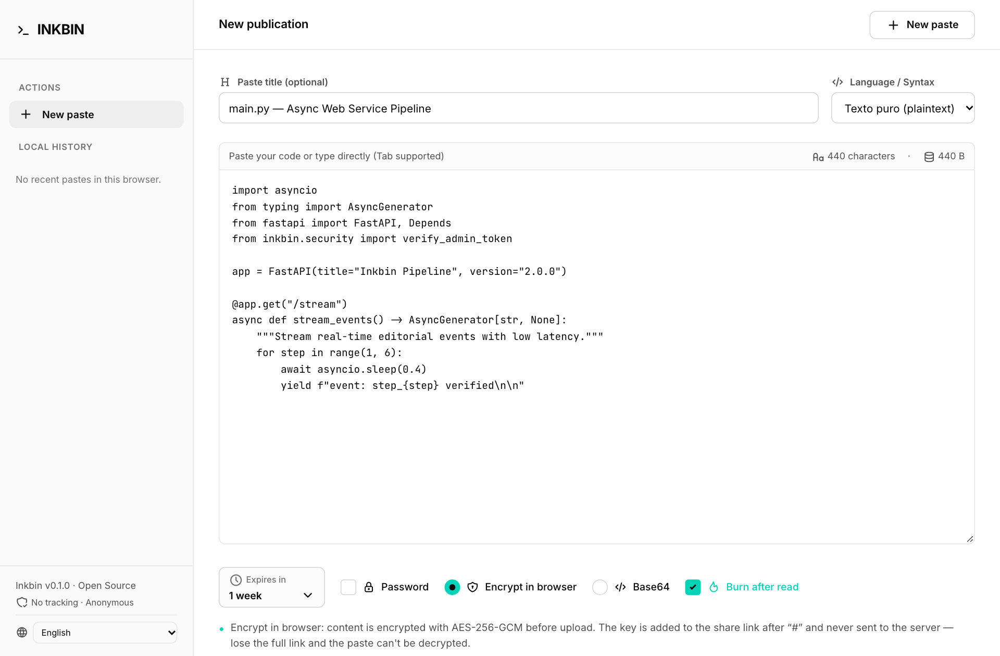
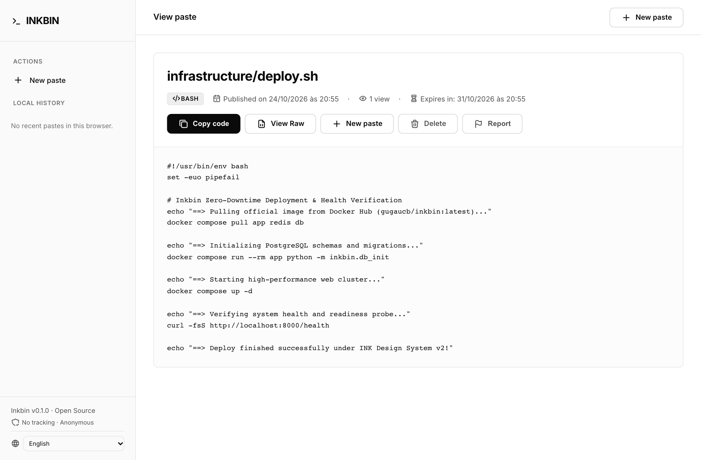
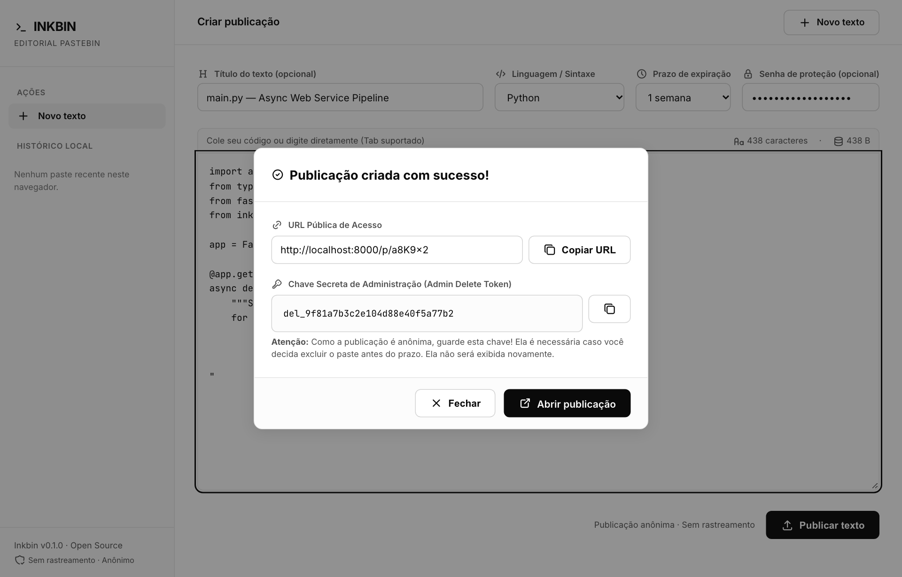
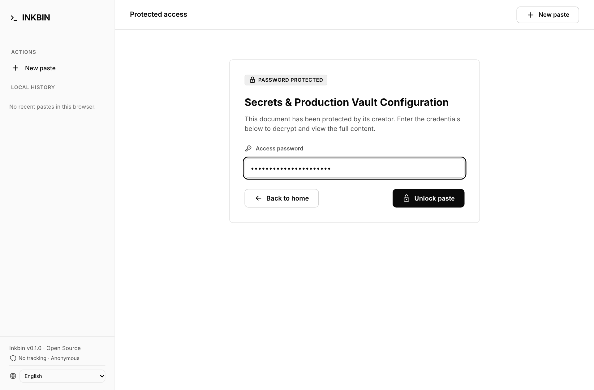
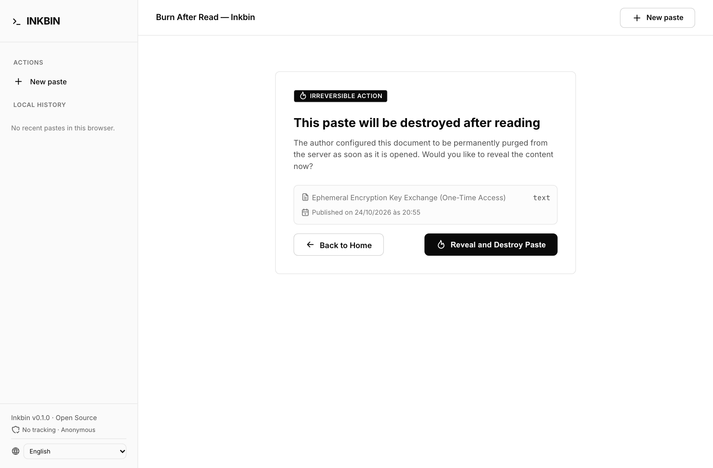

<div align="center">
  🌐 <b>Languages / Idiomas / 语言</b>:
  <a href="README.md">English</a> •
  <a href="README.pt-BR.md">Português (Brasil)</a> •
  <a href="README.zh-CN.md">简体中文</a>
</div>

<br>

<div align="center">

# `>_` INKBIN
### Editorial Pastebin & Anonymous Ephemeral Text Sharing

高性能、安全的开源社论级匿名文本与代码分享平台。生成短小且非顺序生成的混淆 URL，遵循 **INK Design System v2** 排版美学，并提供原生多语言（i18n）支持。

<br>

[](https://python.org)
[](https://fastapi.tiangolo.com)
[](https://postgresql.org)
[](https://redis.io)
[](https://github.com/astral-sh/ruff)
[](https://hub.docker.com/r/gugaucb/inkbin)
[](https://github.com/gugaucb/inkbin/releases)
[](tests)
[](LICENSE)

<br>

[产品宣传片与界面预览](#product-film-gallery) •
[核心特性](#-核心特性) •
[快速开始](#-快速开始) •
[环境变量](#-环境变量配置) •
[终端使用指南 (cURL)](#-终端使用指南-curl) •
[REST API 接口](#-rest-api-接口参考) •
[系统架构](#-系统架构与目录结构) •
[版本发布指南](#-版本发布与版本控制指南) •
[开发与贡献](#-开发与贡献指南) •
[开源许可证](#-开源许可证)

</div>

---

<a id="product-film-gallery"></a>
## 🎬 产品宣传片与界面预览

<div align="center">

<a href="https://youtu.be/yOKRQCSGJmg" target="_blank" title="在 YouTube 上观看 Inkbin 产品宣传片">
  
</a>

<p align="center">
  <b><a href="https://youtu.be/yOKRQCSGJmg">▶ 在 YouTube 上观看产品宣传片 (1080p 超清 • 01:09 分钟)</a></b> •
  <a href="docs/assets/movies/InkBin_Product_Film_EN.mp4">📥 本地下载 / 直接播放 MP4 (6.5 MB)</a>
</p>

</div>

<br>

Inkbin 严格依照 **INK Design System v2** 规范构建，融合高对比度单色社论排版、舒适的触控区域、实时字符统计、原生多语言界面与矢量 Tabler 图标。

| 编辑视图与安全控制栏 (Editor View) | 详情视图 (Viewer View) |
| :---: | :---: |
|  |  |
| *社论级创建表单，集成语法检测、动态过期、浏览器端加密选项（AES-256-GCM / Base64）、阅后即焚开关、青色状态指示点及实时字数计数器。* | *文本阅读器配备元数据面板、浏览量统计、快捷操作栏（复制代码、查看原文、彻底删除、违规举报）及语法高亮。* |

| 发布确认弹窗、二维码与管理密钥 | 密码挑战验证 (Security Gate) |
| :---: | :---: |
|  |  |
| *发布成功后展示带密钥哈希的公开短链接、作者专属管理删除密钥，以及可直接供手机扫码阅读的动态二维码组件。* | *受保护文本挑战页面，要求输入密码并由 Argon2id 密码学验证通过后，方可解密并显示完整文本。* |

<div align="center">

| 阅后即焚确认提示页 (Burn After Read Interstitial) |
| :---: |
|  |
| *一次性文本访问拦截网关，在执行物理永久销毁之前展示文本元数据，并提示不可逆风险。* |

</div>

---

## ⚡ 核心特性

- **匿名发布 (Anonymous Creation)**：即开即用，无需注册登录、绑定邮箱或任何用户追踪与遥测。
- **客户端端到端加密 (Client-Side Encryption)**：浏览器端 AES-256-GCM 零知识加密（解密密钥仅存留在 URL 的 `#` 之后，绝不传入服务端内存）与 Base64 混淆。
- **阅后即焚机制 (Burn After Read)**：一次性阅读文本，在用户首次确认查看后立即从数据库与缓存中永久物理擦除。
- **原生多语言 (Native i18n)**：支持英语（默认 `en`）、巴西葡萄牙语（`pt-br`）及简体中文（`cn`），并在侧边栏底部提供简洁单色切换器，通过安全 Cookie 自动持久化。
- **非连续 Base62 短链接 (Obfuscated Slugs)**：生成 6 至 8 位的紧凑随机混淆 Slug，有效杜绝连续 ID 遍历枚举与自动化抓取。
- **动态保留策略 (`EXPIRATION_OPTIONS`)**：可通过 Docker 环境变量灵活定义文本过期选项（如 `1h,1d,1w,1m,never` 或分钟 `10m,30m`），后台自动执行数据库与缓存物理清除。
- **本地历史记录 (Local History)**：基于浏览器 `localStorage` 安全存储个人发布记录，支持单个项目一键删除（`ti-x`）与全部历史快速清空，实时响应更新 DOM。
- **Argon2id 密码保护 (Protected Pastes)**：使用高抗碰撞及防暴力破解的 Argon2id 算法存储密码散列，连续 5 次输入错误自动触发防爆破频率限制。
- **管理删除凭证与二维码 (Admin Delete Token & QR Code)**：创建时向作者颁发唯一的 64 位不可逆删除凭据，并动态生成二维码方便移动设备即时阅读。
- **防刷限流与突发垃圾防御 (Anti-Spam)**：采用 Redis 滑动窗口限流算法，并基于 SHA-256 内容散列在 60 秒内快速拦截重复内容轰炸。
- **双数据库零配置运行 (Dual-Engine Data)**：生产环境开箱即用支持 **PostgreSQL 16**（配合高性能异步驱动 `asyncpg`），本地开发自动无缝降级为 **SQLite**（`aiosqlite`），无需外部依赖。
- **INK Design System v2 & 无障碍 (A11y)**：符合 WCAG 2.1 AA 标准的单色高对比度社论美学设计，搭配现代无衬线字体与 Tabler 图标集。

---

## 🚀 快速开始

### 方式一：Docker Hub 官方镜像（推荐生产环境与即刻运行）

直接运行发布在 Docker Hub 上的预构建多架构镜像：

```bash
# 单容器运行（内置 SQLite 与持久化数据卷）
docker run -d \
  --name inkbin_app \
  -p 8000:8000 \
  -e APP_ENV=production \
  -e SECRET_KEY="请替换为不少于32个字符的高熵随机密钥" \
  -v inkbin_data:/app/data \
  gugaucb/inkbin:latest
```

或者使用官方 Docker Compose 运行完整的生产集群（FastAPI + PostgreSQL 16 + Redis 7），无需克隆源代码：

```bash
# 1. 下载官方 docker-compose.yml
curl -fsSL https://raw.githubusercontent.com/gugaucb/inkbin/main/docker-compose.yml -o docker-compose.yml

# 2. 启动集群（自动从 Docker Hub 拉取 gugaucb/inkbin:latest 镜像）
docker compose up -d
```

健康检查命令：

```bash
curl -fsS http://localhost:8000/health
# 预期输出: {"status":"ok","app":"inkbin"}
```

---

### 方式二：Docker Compose 源码构建（本地二次开发）

如需修改源码并在本地重新构建镜像：

```bash
# 1. 复制环境变量配置文件
cp .env.example .env

# 2. 本地构建并后台启动服务
docker compose up --build -d
```

查看实时应用日志：

```bash
docker compose logs -f app
```

---

### 方式三：生产部署与 Caddy 自动 HTTPS (集成反向代理)

如需在生产服务器部署并自动签发和续期 Let's Encrypt / ZeroSSL 免费 SSL/TLS 证书，Inkbin 通过 Docker Profile (`caddy` / `proxy` / `production`) 提供了集成的 **Caddy** 反向代理：

```bash
# 1. 在 .env 中配置生产环境变量
cat <<EOF >> .env
COMPOSE_PROFILES=caddy
DOMAIN=paste.yourdomain.com
ACME_EMAIL=admin@yourdomain.com
BASE_URL=https://paste.yourdomain.com
EOF

# 2. 启动集群并启用 Caddy 监听 80 和 443 端口
docker compose --profile caddy up -d
```

> [!TIP]
> **在 Portainer 中部署**:
> 在 Portainer 中创建或编辑 Stack 时，只需在 **Environment variables** 中添加 `COMPOSE_PROFILES=caddy`（或 `production`）、`DOMAIN=paste.yourdomain.com` 和 `ACME_EMAIL=admin@yourdomain.com`，Portainer 将在 80 和 443 端口自动伴随启动 Caddy 容器。

---

### 方式四：无 Caddy 独立部署（适用于 Traefik / Nginx / Cloudflare 外部反向代理）

如果您已有现成的外部反向代理基础设施（如 **Traefik**、**Nginx Proxy Manager**、**Cloudflare Tunnel** 或 **AWS ALB**），或不希望 Caddy 占用宿主机的 80 与 443 端口，可选择以下两种方式之一：

#### 方案 A：专用独立编排文件 (`docker-compose.standalone.yml`)
该文件仅包含核心服务 `app`、`db` (PostgreSQL 16) 与 `redis` (Redis 7)，完全移除了 Caddy 容器定义、80/443 端口占用以及 `caddy_data`/`caddy_config` 持久化卷：

```bash
# 1. 下载官方无 Caddy 独立版编排文件
curl -fsSL https://raw.githubusercontent.com/gugaucb/inkbin/main/docker-compose.standalone.yml -o docker-compose.standalone.yml

# 2. 启动服务集群（Inkbin 直接在 8000 端口提供 HTTP 服务）
docker compose -f docker-compose.standalone.yml up -d
```

> [!NOTE]
> 在此模式下，请将您的外部反向代理目标指向 `http://<服务器IP>:8000`（或共享 Docker 网络中的 `http://inkbin_app:8000`），并确保外部反向代理透传 `X-Forwarded-Proto: https` 与 `Host: <域名>` 请求头。

#### 方案 B：使用标准 `docker-compose.yml`（省略 Profile 参数）
标准 `docker-compose.yml` 中的 Caddy 服务已受 Docker Profile (`profiles: ["caddy", "proxy", "production"]`) 隔离保护。直接执行不带 profile 的命令将仅启动 `app`、`db` 和 `redis`：

```bash
# 仅启动核心服务，不会启动 Caddy
docker compose up -d
```

---

### 方式五：本地开发模式（基于 SQLite 零配置运行）

若无需 Docker 或 PostgreSQL/Redis，应用会自动触发降级保护，使用本地 `inkbin.db` 与内存缓存运行：

```bash
# 1. 创建并激活 Python 3.11+ 虚拟环境
python -m venv .venv
source .venv/bin/activate  # Windows 环境: .venv\Scripts\activate

# 2. 以可编辑模式安装包及开发依赖
pip install -e ".[dev]"

# 3. 启动带热重载的开发服务器
uvicorn inkbin.main:app --reload --port 8000
```

打开浏览器访问 [http://localhost:8000](http://localhost:8000)。

---

## ⚙️ 环境变量配置

所有配置均由 Pydantic `BaseSettings` 在 `.env` 文件中集中化管理：

| 变量名 | 类型 | 默认值 | 说明 |
| :--- | :---: | :---: | :--- |
| `APP_ENV` | `string` | `development` | 运行环境（`development`, `production`, `test`）。 |
| `DEBUG` | `boolean` | `true` | 是否启用调试模式与详细异常堆栈。 |
| `SECRET_KEY` | `string` | `insecure-dev-...` | 32 位以上高强度加密密钥，用于对文本解锁 Token 进行 HMAC 签名。 |
| `HOST` | `string` | `0.0.0.0` | HTTP 服务监听的主机网络接口。 |
| `PORT` | `integer` | `8000` | HTTP 服务监听的 TCP 端口。 |
| `BASE_URL` | `string` | `http://localhost:8000` | 生成公开分享短链接的官方主域名 URL。 |
| `DATABASE_URL` | `string` | `sqlite+aiosqlite:///./inkbin.db` | SQLAlchemy 异步数据库连接字符串。 |
| `REDIS_URL` | `string \| null` | `null` | Redis 缓存与限流连接串（`redis://redis:6379/0`）。留空则使用内存机制。 |
| `RATE_LIMIT_PER_MINUTE` | `integer` | `100` | 单个客户端 IP 每分钟允许的最大请求数。 |
| `MAX_PASTE_BYTES` | `integer` | `1048576` *(1 MB)* | 单篇文本允许的最大字节数限制。 |
| `EXPIRATION_OPTIONS` | `string` | `1h,1d,1w,1m,never` | 允许的过期选项列表（逗号分隔）。支持分钟（`10m`）、小时（`1h`）、天数（`1d`）、周（`1w`）、月（`1m`）及永不过期（`never`）。 |

---

## 💻 终端使用指南 (cURL)

Inkbin 专为命令行环境与自动化脚本做了全面适配：

### 1. 创建普通匿名文本

```bash
curl -X POST http://localhost:8000/api/pastes \
  -H "Content-Type: application/json" \
  -d '{
    "title": "deploy.sh",
    "content": "docker compose up -d",
    "language": "bash",
    "expiration": "1w"
  }'
```

**响应示例：**
```json
{
  "slug": "a8K9x2",
  "url": "http://localhost:8000/p/a8K9x2",
  "admin_delete_token": "del_9f81a7b3c2e104d88e40f5a77b2",
  "title": "deploy.sh",
  "language": "bash",
  "expires_at": "2026-10-30T17:30:00Z",
  "created_at": "2026-10-23T17:30:00Z",
  "is_protected": false
}
```

### 2. 直接管道上传本地代码文件

```bash
# 使用 python 安全封装文本内容：
python3 -c "import json, sys; print(json.dumps({'title': 'main.py', 'language': 'python', 'content': sys.stdin.read()}))" < main.py | \
  curl -s -X POST http://localhost:8000/api/pastes \
    -H "Content-Type: application/json" \
    -d @-
```

### 3. 创建受密码保护的文本 (Protected Paste)

```bash
curl -X POST http://localhost:8000/api/pastes \
  -H "Content-Type: application/json" \
  -d '{
    "title": "机密凭据配置",
    "content": "API_KEY=ink_sec_9941a87b\nDB_PASS=vault_secret_99",
    "language": "yaml",
    "expiration": "1d",
    "password": "MyStrongPassword123"
  }'
```

### 4. 获取纯文本原文内容 (Raw Text)

适用于脚本自动化或 `curl | bash` 场景：

```bash
curl -s http://localhost:8000/raw/a8K9x2
# 或通过 REST API 端点：
curl -s http://localhost:8000/api/pastes/a8K9x2/raw
```

### 5. 使用管理员删除密钥彻底销毁文本

在请求头中携带 `X-Admin-Delete-Token` 即可永久删除文本：

```bash
curl -X DELETE http://localhost:8000/api/pastes/a8K9x2 \
  -H "X-Admin-Delete-Token: del_9f81a7b3c2e104d88e40f5a77b2"
```

---

## 🔌 REST API 接口参考

所有响应体均采用 UTF-8 编码的标准 JSON。

| HTTP 方法 | 请求路径 | 请求头 / 参数 | 功能描述 | 状态码 |
| :--- | :--- | :--- | :--- | :--- |
| `POST` | `/api/pastes` | `Content-Type: application/json` | 创建新文本（匿名或密码保护）。 | `201 Created`, `400 Bad Request`, `413 Payload Too Large`, `422 Unprocessable Entity`, `429 Too Many Requests` |
| `GET` | `/api/pastes/{slug}` | — | 获取文本的元数据与详细内容。 | `200 OK`, `401 Unauthorized` *(受密码保护)*, `404 Not Found`, `451 Unavailable For Legal Reasons` |
| `GET` | `/api/pastes/{slug}/raw` | — | 以纯文本格式（`text/plain`）获取原文。 | `200 OK`, `401 Unauthorized`, `404 Not Found`, `451 Unavailable For Legal Reasons` |
| `GET` | `/raw/{slug}` | — | 规范的短路径纯文本下载直链。 | `200 OK`, `401 Unauthorized`, `404 Not Found` |
| `POST` | `/api/pastes/{slug}/unlock` | `Content-Type: application/json` | 校验密码并颁发解密凭证 Cookie。 | `200 OK`, `401 Unauthorized`, `404 Not Found`, `429 Too Many Requests` *(5 次失败后限流)* |
| `DELETE`| `/api/pastes/{slug}` | `X-Admin-Delete-Token: <token>` | 从数据库物理清除文本并使缓存失效。 | `200 OK`, `401 Unauthorized`, `404 Not Found` |
| `POST` | `/api/pastes/{slug}/report` | `Content-Type: application/json` | 提交违规举报（`spam`, `malware`, `leak`, `abuse`, `other`）。 | `200 OK`, `400 Bad Request`, `404 Not Found` |
| `PATCH`| `/api/pastes/{slug}/deactivate`| — | 管理员下架并封禁违规文本。 | `200 OK`, `404 Not Found` |
| `GET` | `/set-locale/{locale}` | — | 快速切换语言（`en`, `pt-br`, `cn`）并写入 Cookie。 | `303 See Other` |
| `GET` | `/health` | — | 服务运行健康状态检查。 | `200 OK` |

---

## 🏗️ 系统架构与目录结构

Inkbin 采用现代化异步分层架构，清晰划分领域模型、业务服务、数据库适配器与表现层：

```
TextEditor/
├── src/
│   └── inkbin/
│       ├── config.py           # Pydantic BaseSettings 集中化环境配置
│       ├── db.py               # SQLAlchemy 2 Asyncio 数据库与版本迁移引擎
│       ├── expiration.py       # 动态保留期限解析与 EXPIRATION_OPTIONS 管理
│       ├── i18n.py             # 国际化语言解析器、级联匹配与 t() 助手函数
│       ├── locales/            # 语言包目录（en.json, pt-br.json, cn.json）
│       ├── models.py           # 数据库关系映射模型（Paste, PasteReport）
│       ├── schemas.py          # API 输入输出校验与序列化模式
│       ├── services.py         # 核心业务逻辑与数据库原子操作
│       ├── slug.py             # Base62 混淆短链接生成器（6-8 字符）
│       ├── security.py         # Argon2id 加密散列、管理密钥与访问凭证签名
│       ├── rate_limit.py       # 异步限流与内容防刷拦截中间件
│       ├── cache.py            # 双级缓存（L1 内存 / L2 Redis）
│       ├── lifecycle.py        # 文本生命周期调度与自动物理清除逻辑
│       ├── main.py             # FastAPI 应用入口、中间件装载与生命周期管理
│       ├── routes/
│       │   ├── api.py          # 核心 RESTful API 路由定义
│       │   └── web.py          # Jinja2 模板页面渲染与语言切换处理
│       ├── static/             # INK Design System 样式表 (CSS)、JS 与字体
│       └── templates/          # 语义化 Jinja2 模板（集成 Tabler 图标与 i18n）
├── tests/                      # 自动化测试用例集（pytest）
├── docs/                       # 架构设计决策记录 (ADR) 与说明文档
│   ├── adr/                    # Architecture Decision Records
│   ├── agents/                 # Agent 规范手册
│   └── assets/screenshots/     # 界面高清演示截图
├── docker-compose.yml          # 多容器集群定义（App, PostgreSQL 16, Redis 7）
├── Dockerfile                  # 轻量级多阶段构建 Dockerfile
├── pyproject.toml              # 项目依赖与开发工具配置（Ruff / pytest）
└── GLOSSARY.md                 # 领域通用词汇表
```

---

## 🤝 开发与贡献指南

欢迎社区开发者参与贡献！参与步骤如下：

### 1. 环境准备

```bash
# 克隆代码仓库
git clone https://github.com/gugaucb/inkbin.git
cd inkbin

# 创建功能分支
git checkout -b feat/my-feature

# 配置虚拟环境与依赖
python -m venv .venv
source .venv/bin/activate
pip install -e ".[dev]"
```

### 2. 运行自动化测试

本项目保持严格的自动化测试覆盖：

```bash
pytest
```

### 3. 代码风格与规范校验

本项目使用 [Ruff](https://github.com/astral-sh/ruff) 保证代码质量：

```bash
# 代码静态分析与规范检查
ruff check .

# 代码格式化校验
ruff format --check .

# 自动格式化修复
ruff format .
```

---

## 🏷️ 版本发布与版本控制指南

Inkbin 采用语义化版本管理标准，并打通了 GitHub Actions 自动化构建多架构 Docker 镜像与 GitHub Release 流程：

- **语义化版本规范 (SemVer)**：版本标签遵循 `vX.Y.Z` 规范（例如 `v0.1.0`）。
- **Docker Hub 自动化流水线**：每当向仓库推送版本标签，GitHub Actions 会自动编译多架构镜像（`linux/amd64` 与 `linux/arm64`），并推送至 `gugaucb/inkbin` 仓库，同时标记 `latest`、`X.Y.Z`、`vX.Y.Z` 及 `X.Y` 标签。
- **GitHub Releases 自动化**：自动根据提交日志生成包含分类变更记录的官方版本发布页面。

发布新版本的操作步骤：

```bash
# 1. 确保测试套件与代码规范检查 100% 通过
pytest && ruff check .

# 2. 创建附注标签并推送到远端仓库
git tag -a v0.1.0 -m "Release v0.1.0"
git push origin v0.1.0
```

关于自动化流水线配置、GitHub Secrets 密钥设置及详细发布说明，请参阅 [版本发布指南 (Release Guide)](docs/release-guide.md)。

---

## 📄 开源许可证

本项目基于 [MIT](LICENSE) 开源许可证发布。

<div align="center">
  <sub>专注于隐私保护、极致极简与高雅社论级排版体验。</sub>
</div>
